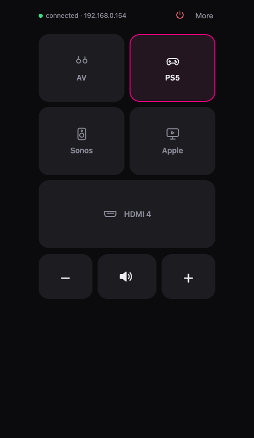

# LG Remote

A fast, minimal web remote for LG webOS TVs. Built for the setup where a streaming box (Apple TV) has its own remote, and the TV remote is only needed to **switch HDMI inputs and change the volume**.



- **Minimal view (default):** one-tap input switching with icons, volume and mute, power. Fits on one screen.
- **Full remote, one tap away:** D-pad, back/home, media keys, channels, app launcher, inputs, text entry, and a touchpad for the Magic Remote cursor.
- **Instant:** a small local server keeps one connection to the TV open, so every tap goes straight down an existing socket. The UI updates optimistically.
- **Wake-on-LAN** to turn the TV on, with the TV's MAC address learned automatically.
- **No cloud, no account.** Everything stays on your network. Add it to your phone's home screen and it behaves like an app.

Tested on an LG OLED55B9 (2019, webOS 4.5). Should work on any webOS TV that supports LG's second-screen API (SSAP).

## Setup

Requires Node 20+.

```sh
git clone https://github.com/HugoLiconV/lg-remote.git
cd lg-remote
npm install
npm start
```

Open the printed `http://<your-computer>:8080` address on your phone, then:

1. Under **Setup**, tap **Find TV on network**, or enter the TV's IP address.
2. Tap **Connect** and choose **Allow** on the TV. No working remote? Use the joystick button under the bottom-center of the TV.
3. Add the page to your home screen (Safari: Share → Add to Home Screen).

The pairing key, IP and MAC are saved to `config.json`, which is git-ignored.

To turn the TV on from the app, enable **Settings → Connection → Mobile Connection Management → TV On With Mobile** on the TV.

## Keep it running (macOS)

```sh
./scripts/install-service.sh
```

This installs a launchd agent that starts the server at login and restarts it if it crashes. Use the `http://<hostname>.local:8080` address it prints so your bookmark keeps working when your IP changes. Logs go to `/tmp/lg-remote.log`.

Uninstall:

```sh
launchctl bootout gui/$(id -u)/com.lg-remote && rm ~/Library/LaunchAgents/com.lg-remote.plist
```

On a Raspberry Pi or other Linux box, run `npm start` under systemd or pm2.

## How it works

- `lgtv.js`: SSAP client. Connects to `wss://<tv>:3001` (newer firmware) and falls back to `ws://<tv>:3000`, pairs, and opens the pointer-input socket used for button presses. Also includes Wake-on-LAN and SSDP discovery.
- `server.js`: HTTP server that serves the page and exposes `/api/*` actions (input, volume, power, buttons, apps).
- `public/index.html`: the whole UI, with no build step.

The pairing manifest (`pairing.json`) comes from [lgtv2](https://github.com/hobbyquaker/lgtv2) (MIT).

## License

MIT
